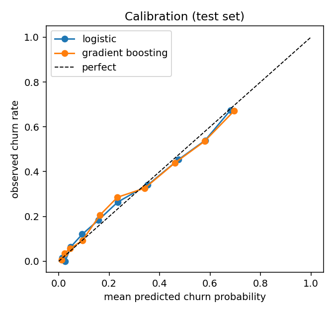
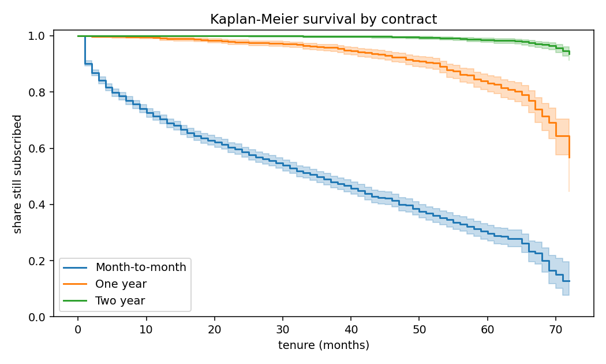
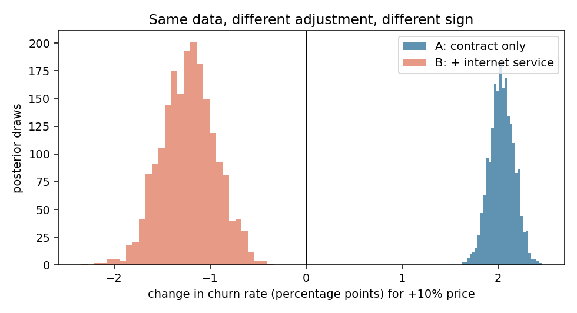
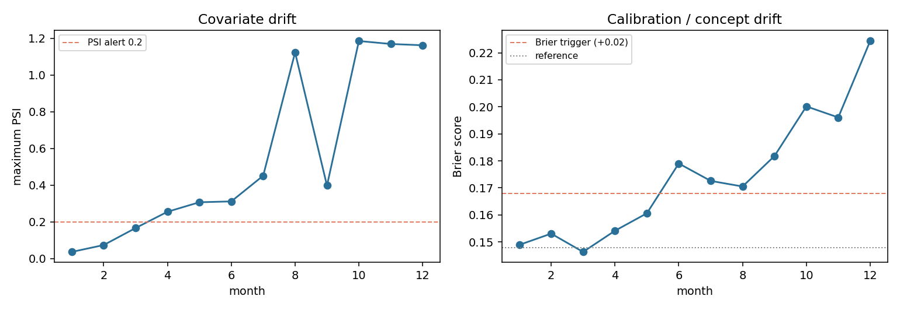

# Churn, survival and price effects for a subscription business

[](https://github.com/Khainga-code/telco-churn-survival/actions/workflows/ci.yml)

**Business question:** which customers will leave early enough to act on, when do
they leave, who is worth contacting, and what would a price change do?

This project follows that chain end to end on the public **IBM Telco Customer
Churn** dataset (7,043 customers, 26.5% churned), used as a stand-in for a
pay-as-you-go style subscription business. It is **not PAYG, solar or LPG data**,
and nothing here is a claim about those businesses.

The short version: a simple, calibrated model is enough to rank risk; the value
comes from turning the ranking into a capacity-constrained contact queue; and the
price question cannot be answered from this data at all. Showing that last point
is part of the result.

## What I found

| Question | Method | Result |
|---|---|---|
| Does a complex model beat a simple one? | Logistic regression vs gradient boosting, 5-fold CV plus held-out test, paired bootstrap | **No.** Test ROC-AUC **0.818** [0.794, 0.840] vs 0.813 [0.788, 0.836]; ΔAUC **+0.005** [−0.001, +0.011], interval includes zero. Use the logistic model. |
| Are the probabilities trustworthy? | Calibration curve and slope | **Yes.** Calibration slope 0.92; top decile 68% predicted vs 67% observed. |
| Who should be contacted? | Capture rate and expected-value queue | Top 20% by risk captures **46%** [41, 50] of churners at 61% precision (base rate 27%). At the £10/£300/30% assumptions, contact above **11%** risk: 884 of 1,409 holdout customers, expected **£23.0k** vs **£19.6k** for contacting everyone. |
| Does ranking by value beat ranking by risk? | Expected margin per customer | **Yes, modestly.** At 500 contacts, value ranking adds **£961** (about 4%) over risk ranking and changes 13% of the names. |
| When do customers leave? | Kaplan-Meier, log-rank, RMST, Cox | 12-month survival **70%** (month-to-month) vs **99%** (one-year) and **100%** (two-year); **6.5 subscription-months lost** by month 24. Fibre hazard **4.35×** DSL within contract strata [3.57, 5.30]. |
| What does a 10% price rise do? | Bayesian logistic regression, two adjustment sets | **It depends on the model.** **+2.04pp** churn controlling for contract only, **−1.23pp** once internet service type is added. Price-fibre correlation 0.79; price VIF 1.0 → 5.4; E-value 1.27–1.36. Not a causal elasticity. |
| How big must a retention experiment be? | Power, design effect, difference-in-differences | **1,494 per arm** for a 5pp reduction. With area randomisation (40 customers/cluster, ICC 0.03): **3,242 per arm, 82 clusters**. A simulated DiD recovers −3.9pp against a true −4pp where the naive comparison says +3.8pp. |
| When would we retrain? | PSI trajectory plus Brier trigger | In a simulated year, the documented trigger fires in **month 4** on `MonthlyCharges` (PSI 0.25) before the Brier score has visibly moved. |






## Review this in 10 minutes

1. [`reports/decision_memo.md`](reports/decision_memo.md) - one page, commercial
   recommendation and what would change it.
2. [`notebooks/02_models_calibration_value.ipynb`](notebooks/02_models_calibration_value.ipynb) -
   model comparison with intervals, calibration, decision curve, value queue.
3. [`notebooks/04_bayesian_price_effect.ipynb`](notebooks/04_bayesian_price_effect.ipynb) -
   the sign flip, the collinearity that causes it, and the sensitivity analysis.
4. [`src/telco_churn/evaluate.py`](src/telco_churn/evaluate.py) - the oracle/expec-ted
   value distinction and the bootstrap helpers.
5. [`reports/results.json`](reports/results.json) - every headline number, machine-readable.

## Design choices worth knowing

- **Leakage avoided, and tested.** `tenure` and `TotalCharges` are only known after
  a customer has stayed; for churners, `tenure` is how long they lasted. The
  classifier uses signup-time features only, and a unit test fails if a leaky
  column enters the feature matrix. Tenure is used properly as time-to-event in
  notebook 03.
- **The threshold is chosen out of sample.** It is selected on out-of-fold
  predictions from the training split and evaluated once on the held-out test set.
  Choosing it on the test set - as the first version did - is optimistic.
- **Oracle and expected value are reported separately.** The oracle curve uses true
  labels and is a ceiling; the expected curve is what a campaign can forecast. The
  gap is the value of perfect information, not a return.
- **Calibration is checked, not assumed.** A value calculation multiplies
  probabilities by money, so a slope of 0.92 and a diagonal curve are part of the
  evidence, not an appendix.
- **The proportional-hazards assumption is tested.** It fails for contract and
  price, so hazard ratios are reported as time-averages and the contract-stratified
  model is the robustness check.
- **The price result is framed as a fragility, not a finding.** E-values quantify
  how little unmeasured confounding would be needed to explain it away.
- **The economics are swept, not asserted.** `reports/results.json` carries a
  one-at-a-time sensitivity on the three placeholders: doubling the contact cost,
  halving the save rate, or halving the value saved each move the cut-off from 11%
  to 22% and the contact list from 884 to 650 customers.
- **Monitoring is executable.** `telco_churn.drift` computes PSI and a documented
  retraining trigger (any feature above 0.2, or Brier worsening by more than 0.02)
  with an owner and a review window. Notebook 06 runs it across a simulated year.
- **The model is an artefact, not a notebook cell.** `train_baselines.py` saves a
  joblib pipeline with a JSON sidecar (features, threshold, economics, library
  versions, test metrics); `scripts/score.py` consumes it and writes a ranked queue.

## Notebooks

| # | Notebook | Focus |
|---|---|---|
| 01 | `01_framing_and_eda` | Business framing, where churn concentrates, leakage warning |
| 02 | `02_models_calibration_value` | Model comparison with intervals, calibration, decision curve, value queue, economics sensitivity, drift check |
| 03 | `03_survival_analysis` | Kaplan-Meier with bands, log-rank, RMST, Cox, proportional-hazards test, stratified model |
| 04 | `04_bayesian_price_effect` | Causal diagram, collinearity, posterior price effect, posterior predictive check, prior sensitivity, E-value |
| 05 | `05_experiment_design` | Sample size, MDE curve, clustering, difference-in-differences with event study |
| 06 | `06_monitoring` | PSI and Brier over a simulated year, retraining trigger |

All notebooks are executed with outputs included.

## Quickstart

```bash
python -m venv .venv
# Windows: .venv\Scripts\activate
source .venv/bin/activate
pip install -e ".[all]"          # or: pip install -r requirements-dev.txt
python scripts/download_data.py  # verifies the file hash
python scripts/train_baselines.py
python scripts/score.py --capacity 500
pytest
jupyter lab notebooks/
```

Or, with `make`: `make all` runs data, training, scoring and the fast notebooks.

MLflow is optional. If it is installed, `train_baselines.py` logs every run to a
local SQLite store:

```bash
mlflow ui --backend-store-uri sqlite:///mlflow.db
```

Seeds are fixed (42), and `reports/results.json` is regenerated by the training
script, so the numbers in this README can be checked rather than trusted.

## Repository layout

```
src/telco_churn/
  data.py        download + hash check + documented cleaning
  features.py    signup-time feature set, leakage guard, preprocessing
  schema.py      column, category and range validation
  economics.py   the three commercial assumptions in one object
  evaluate.py    metrics, bootstrap intervals, calibration, decision curve, value curves
  targeting.py   expected-value ranking, capacity selection, segment report
  scoring.py     raw frame -> ranked contact queue
  model.py       pipeline build, save/load with metadata sidecar
  drift.py       PSI, drift report, trajectory, retraining trigger
  cli.py         `telco-score` entry point
scripts/         download, train, score
notebooks/       six executed notebooks
tests/           40 unit tests
reports/         figures, results.json, decision memo, example contact queue
models/          fitted pipeline + metadata
```

## Tests and CI

- 40 unit tests covering evaluation, calibration, targeting, drift, schema
  validation, feature leakage and model persistence.
- `ruff` for linting.
- GitHub Actions runs the test suite on Python 3.10 and 3.12, trains the model,
  scores a queue, and executes notebooks 01, 02, 03, 05 and 06 so notebook outputs
  cannot silently rot. Notebook 04 is excluded from CI because PyMC sampling is
  slow and platform-sensitive; run `make notebooks-bayes` locally.

## Limitations

- Observational, single-snapshot data from one business. Results do not transfer to
  PAYG lending, solar or LPG.
- The economics (`value_saved=£300`, `contact_cost=£10`, `save_rate=30%`) are
  placeholders. Every money figure inherits them.
- The value queue assumes value at risk is proportional to the monthly bill and
  normalised to the average customer. A real business would use expected lifetime
  margin, which needs survival and expansion/contraction assumptions.
- A churn model ranks risk; it does not estimate the effect of an offer. The save
  rate is assumed constant, which is exactly what uplift modelling relaxes. The
  experiment in notebook 05 is how that assumption would be tested.
- The Cox model is a time-average because proportional hazards fails; the
  stratified model mitigates but does not eliminate this.
- The monitoring year is simulated. It demonstrates the mechanics, not the true
  drift rate of this business.
- The difference-in-differences example is simulated to illustrate the method, not
  estimated from real field data.

## Data and licence

The IBM Telco Customer Churn sample is downloaded at run time from IBM's public
GitHub repository (`IBM/telco-customer-churn-on-icp4d`). Check its terms before
redistributing the raw file; `data/*.csv` is git-ignored. The code in this
repository is MIT licensed.
